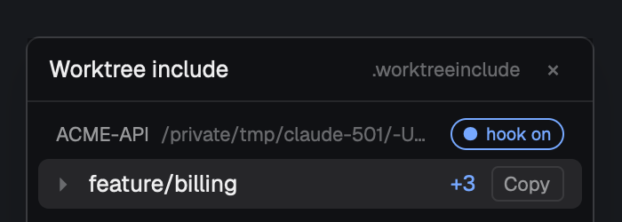

# Worktree include for Herdr

New git worktrees come ready to run. List the gitignored files a checkout
needs (`.env`, `.npmrc`, local config) in a `.worktreeinclude` file, and every
new worktree of that repo gets them copied in from the main checkout.



- **Works everywhere:** Herdr's New worktree, Claude Code, or plain
  `git worktree add`, with Herdr open or closed.
- **Ready before you start:** the files are in place before the new space
  opens or an agent starts in it.
- **Never overwrites:** a file the worktree already has is left alone.
- **Same file as Claude Code:** `.worktreeinclude` is the file Claude Code
  already reads for its own worktrees, so one list covers both.

## Install

Ask your agent in Herdr:

> Add the Herdr mod at github.com/madwire/herdr-worktreeinclude

Or by hand:

1. Copy `mods/worktreeinclude/` into `~/.config/herdr-app/mods/`.
2. Merge the two keys from `keys.json` into the `global` section of
   `~/.config/herdr-app/keys.json`. Keep your own bindings if either key is
   already taken.
3. Run `herdr-app check ~/.config/herdr-app/mods/worktreeinclude`.
4. Press `cmd-alt-i` to open the window.

## Use

1. Add a `.worktreeinclude` to the root of your repo. It uses gitignore
   syntax, for example:

   ```gitignore
   # Copied into each new worktree
   .env
   .npmrc
   config/local.json
   ```

   Only files that match a line **and** are ignored by git get copied. Tracked
   files arrive with the checkout anyway. A bare `.env` matches at any depth
   (`.devcontainer/.env` too); write `/.env` for just the top-level one.

2. Open the Worktree include window (`cmd-alt-i`) and open a space on the
   repo. The repo shows `● hook on` and a toast confirms it. That's it: from
   now on, new worktrees of this repo get the files.

| Key | What it does |
|---|---|
| `cmd-alt-i` | Open the Worktree include window |
| `cmd-alt-shift-i` | Copy anything missing into the current worktree (while the window is open) |

On Windows `cmd` is the Win key and `ctrl-alt` is AltGr, so bind something
like `ctrl-shift-i` and `alt-shift-i` instead.

In the window:

- Each worktree space shows what it got: `+3` means three files were
  copied, `6 ✓` means everything was already there.
- **Copy** copies anything that's missing now, for example after you add a
  line to `.worktreeinclude`.
- Click a row to switch to its space, or ▸ to see the copied files.
- Click `● hook on` to switch a repo off, and `○ hook off` to switch it back
  on.

## What it changes

To copy files when Herdr isn't running, the mod writes a small git hook to
`.git/hooks/post-checkout` in each repo that has a `.worktreeinclude`. The
hook:

- runs only when a new worktree is created, not on normal branch switches;
- copies files only between checkouts on the same machine;
- always lets git finish, even if a copy fails;
- is marked `herdr-worktreeinclude`, and the mod never touches a hook it
  didn't write.

If a repo already has its own `post-checkout` hook, or manages hooks with
`core.hooksPath` (husky, lefthook), the mod leaves them alone. The window
says so and copies files itself instead, but only while it's open.

## Remove

- **One repo:** click `● hook on` in the window, or delete
  `.git/hooks/post-checkout` from that repo.
- **The whole mod:** switch every repo off first, then delete
  `~/.config/herdr-app/mods/worktreeinclude/` and the two keys. Hooks stay in
  repos you didn't switch off. To find them:

  ```sh
  grep -l herdr-worktreeinclude ~/path/to/repos/*/.git/hooks/post-checkout
  ```

## Requirements

- macOS, Linux or Windows, and git 2.31 or newer. Needs `sh`; on Windows the
  one from Git for Windows (`C:/Program Files/Git/bin/sh.exe`).
- Bare repos are skipped. `git worktree add --no-checkout` doesn't run the
  hook, so those worktrees only get files while the window is open.

## Building it yourself

[`RECIPE.md`](RECIPE.md) is a full brief: an agent with an empty folder can
build this mod from it.
