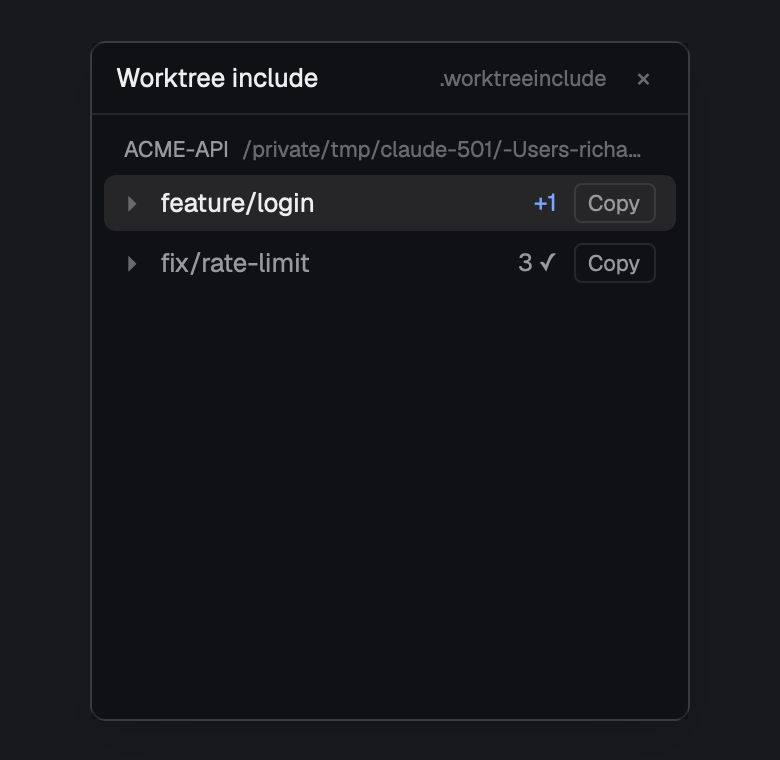

# Worktree include

A small floating window that makes new git worktrees ready to run. When a
space opens on a linked worktree, the window copies in the gitignored files
the repo lists in its `.worktreeinclude` (`.env`, `.env.local`, local
config and so on) from the main checkout, and a toast says what arrived. It
never overwrites a file that's already there. The window lists every open
worktree space under its repo, with what was copied and a Copy button to
fetch anything missing again.

## What you see

- **A floating window**, 300×260px, opened with `cmd-alt-i`. It's a Herdr
  window overlay: drag it anywhere, it remembers its spot and reopens on the
  next start until closed. Background is the theme's `chrome`, with Herdr's
  own window border and shadow.
- **Title bar**, 36px, a 1px `border` line below it: "Worktree include"
  (13px semibold, `foreground`) on the left. On the right: `.worktreeinclude`
  (11px, `dim`) and a 20×20 "×" close button (`dim`, `raised` background and
  `foreground` on hover).
- **A scrolling list** with 6px padding and 10px between repos. For each repo:
  - **Repo header**, 22px, 11px type: the main checkout's folder name in
    uppercase, semibold, `muted` (`ACME-API`), then the main checkout's path
    with home as `~` (`dim`, truncated). A remote repo shows `machine:path`.
  - **One 28px row per worktree space** (6px corners, 10px side padding):
    a fold triangle `▸`/`▾` (`dim`), the branch name (truncated; `foreground`
    for the shown space, else `muted`), a status (12px), and a Copy button
    (11px, `muted`, 1px `border`, 4px corners, 20px high).
  - **Unfolded**, under the row (28px left indent, 11px, `dim`): the worktree's
    path, then each copied file as `+ .env.local` (`muted`, first 30, then
    "… N more"), "N already there, left alone", "No .worktreeinclude in
    <main>", or the first line of an error in `blocked`.
- **Empty**: "No worktree spaces open." (12px, `muted`), then "Make one with
  New worktree. Gitignored files that match the repo's .worktreeinclude are
  copied into it." (`dim`).

## How it behaves

- **A new worktree space** (made with Herdr's New worktree, or any space whose
  first terminal is in a linked worktree): within about a second the row
  appears with a braille spinner (`⠋⠙⠹…`, 90ms, `working` color). The mod
  lists matching files in the main checkout and copies each one that's
  missing, creating folders as needed and keeping file modes and times. When
  it's done, the status becomes `+3` in `done` color, and a success toast
  says "Copied 3 files into feature/login" with the first four names.
- **What gets copied**: untracked files in the main checkout that match a
  pattern in `<main>/.worktreeinclude` (gitignore syntax: `.env`,
  `config/local.json`, `secrets/`) **and** are ignored by git. Tracked files
  arrive with the checkout anyway; an ignored file the list doesn't name
  (`node_modules/`, `*.log`) stays put.
- **Never overwrites**: a file or link that already exists in the worktree
  is skipped and counted under "already there, left alone".
- **Each worktree is handled once on its own.** It's remembered, so delete a
  copied file and it stays deleted. After a restart or reload, remembered
  worktrees show `3 ✓` (how many files match, `muted`) instead of copying
  again; `nothing` when none match.
- **Statuses**: spinner (looking or copying), `+N` (copied this time), `N ✓`
  (all there), `nothing`, `no list` (`dim`: the repo has no
  `.worktreeinclude`), `N files: click` (`blocked`: over 2000 matches, not
  copied without a click), `failed` (`blocked`; unfold for the error).
- **Clicks**: a row selects its space (`space.select`). The triangle unfolds
  and folds without selecting it. **Copy** copies whatever is missing now,
  including past the 2000 limit, and shows the result. Presses on rows and
  buttons don't drag the window; anywhere else drags it.
- **Keys**: `cmd-alt-i` opens (or brings back) the window.
  `cmd-alt-shift-i` copies into the shown space's worktree, the same as its
  Copy button. In a space that isn't a linked worktree, it shows a "Not a
  worktree" toast. The key only works while the window is open.
- The shown space's row has the `selected` background; rows get `hover` on
  hover. Rows go when their space closes.

## Built from

- `mods/worktreeinclude/main.js`: one `View`, about 240 lines, no assets.
- `mods/worktreeinclude/mod.json`: `{ "place": "none", "title": "Worktree
  include", "overlay": { "kind": "window", "width": 300, "height": 260,
  "key": "worktreeinclude", "keep": true } }`. Not docked, because Herdr's
  shipped layouts don't take new blocks. `mod.open` opens it as a kept
  window, which works on any layout.
- `keys.json` (merge into the person's `global`):
  `"cmd-alt-i": "mod.open:worktreeinclude"`,
  `"cmd-alt-shift-i": "worktreeinclude.copy"`.
- `herdr` functions: `spaces()`, `panes()` (a space's place is its first
  terminal's `cwd`, else `space.folder`, as the shipped `worktree` mod works
  it out), `exec` (with `on: space.machine`), `notify`, `focused`,
  `nextCommand` (`"copy"`), `home`, `props().overlay` / `closeOverlay`,
  `run("space.select", {id})`, `theme()`, `localStorage` (key `"done"`: a JSON
  list of handled worktrees, the last 500).
- **Finding worktrees**: `cx.timer.every(1000)` walks `spaces()` in plain JS.
  Only a place it hasn't seen before (`[machine, path]`) costs git calls:
  `git rev-parse --show-toplevel` and `git rev-parse --path-format=absolute
  --git-common-dir`. A linked worktree is one whose common dir ends in
  `/.git` and whose parent (the main checkout) isn't its top. Branch comes
  from `git branch --show-current`.
- **Listing**, run with `sh -c` in the main checkout:
  `git ls-files -z --others --ignored --exclude-from=.worktreeinclude | git
  check-ignore -z --stdin` (NUL-separated). It first checks
  `[ -f "$main/.worktreeinclude" ]`.
- **Copying**: `sh -c` with `src dst file…` as arguments, 200 files per call.
  For each file: skip if `[ -e ]` or `[ -L ]` in the worktree, else `mkdir -p`
  its folder and `cp -p`, printing the name. Its output is the copied list.
- Programs: `git` and `sh` (on the space's machine).

## Watch out

- **A mod runs only while it's shown.** Close the window and nothing copies
  until it's open again. Because it's a kept window, it comes back by itself
  after a restart. A layout switch closes windows: the kept window comes back
  when its layout shows again, but not on the new layout.
- **Race with a first-tab agent**: New worktree can start an agent in the
  new space at once, and the copy lands around a second after the space
  appears. A program that reads `.env` at its first instant can miss it.
- `stop_propagation` is on `cx`, not on the event:
  `.on_click((e, cx) => cx.stop_propagation())`. Clickable parts also need
  `.on_mouse_down("left", (_e, cx) => cx.stop_propagation())`, or pressing
  them drags the window.
- A first build written with `"place": "right"` never docked on the shipped
  `main` layout and so never ran. Use the window.
- The toast's `icon` must be a real icon name or it draws a blank square;
  this build sends none.
- The `.worktreeinclude` used is the **main checkout's** working copy, not
  the worktree's. Changing it later doesn't touch worktrees already handled;
  press Copy. A repo without the file is remembered as handled too, so adding
  the file later needs Copy for worktrees already open.
- Needs a POSIX `sh` on the space's machine, so a Windows machine without
  one shows `failed`. Bare repos (common dir not ending in `/.git`) are
  skipped.
- Copies can include secrets: they go only between checkouts on the same
  machine, and nothing leaves it.
- 2000 matches is the most it copies without a click. Unfolded rows list 30
  files.

## Done when

- `herdr-app check mods/worktreeinclude` passes, and `cmd-alt-i` opens the
  window with the empty message when no worktree space is open.
- In a repo whose `.gitignore` has `.env`, `.env.local`, `config/local.json`,
  `node_modules/` and `*.log`, all present in the main checkout, and whose
  `.worktreeinclude` lists the first three: `git worktree add -b feature/login
  ../wt/feature-login`, then `herdr-app do space.new --folder
  <that path>`. Within a few seconds the worktree has `.env`, `.env.local` and
  `config/local.json` (same contents) and no `node_modules` or `debug.log`.
  The row reads `feature/login +3`, and a toast says "Copied 3 files into
  feature/login".
- A second worktree that already has its own `.env` keeps it unchanged and
  gets only the other two (`+2`).
- Delete `.env.local` from the first worktree, select its space and press
  `cmd-alt-shift-i` (or Copy). It comes back, the row reads `+1`, and the
  toast names it.
- After saving `main.js` (a reload), both rows read `3 ✓` and nothing is
  copied again.
- A space on the main checkout, or outside git, gets no row.
